<a href="./README.md">Français</a> · <strong>English</strong>

<a href="https://www.grimael.dev/">
  <picture>
    <source media="(prefers-color-scheme: dark)" srcset="./assets/banner-en-dark.svg">
    <source media="(prefers-color-scheme: light)" srcset="./assets/banner-en-light.svg">
    
  </picture>
</a>

# Statistics, Data Science & Engineering

I'm **Michaël S. GRIMA**, a statistician trained at [ENSEA in Abidjan](https://ensea.ed.ci/). I connect statistical analysis, data engineering and application development to turn raw data into useful decisions.

My experience spans **insurance, public service and vocational training** in Côte d’Ivoire.

  <a href="https://www.grimael.dev/"><strong>Portfolio</strong></a>
  &nbsp; / &nbsp;
  <a href="https://www.linkedin.com/in/grimael">LinkedIn</a>
  &nbsp; / &nbsp;
  <a href="mailto:grimael.s@outlook.com">Get in touch</a>

## Selected work

From preparing the data to building the application that makes it useful.

<table>
  <tr>
    <td width="50%" valign="top">
      <a href="https://github.com/grimael/opendataviz-pipeline"><picture><source media="(prefers-color-scheme: dark)" srcset="./assets/projects/opendataviz-dark.svg"><source media="(prefers-color-scheme: light)" srcset="./assets/projects/opendataviz-light.svg"></picture></a>
      
<strong><a href="https://github.com/grimael/opendataviz-pipeline">OpenDataViz</a></strong> An observatory for exploring Africa’s economic and social data, from the ETL pipeline to the dashboard.

      
<code>Python</code> <code>DuckDB</code> <code>FastAPI</code>

      
<a href="https://github.com/grimael/opendataviz-pipeline">Source code</a> · <a href="https://www.grimael.dev/projects/opendataviz-observatoire-afrique/">Case study</a>

    </td>
    <td width="50%" valign="top">
      <a href="https://github.com/grimael/nps-fairness-modeling"><picture><source media="(prefers-color-scheme: dark)" srcset="./assets/projects/nps-dark.svg"><source media="(prefers-color-scheme: light)" srcset="./assets/projects/nps-light.svg"></picture></a>
      
<strong><a href="https://github.com/grimael/nps-fairness-modeling">NPS &amp; Fairness</a></strong> Predicting customer satisfaction while accounting for selection bias, interpretability and model fairness.

      
<code>scikit-learn</code> <code>LightGBM</code> <code>SHAP</code>

      
<a href="https://github.com/grimael/nps-fairness-modeling">Source code</a> · <a href="https://www.grimael.dev/projects/prediction-nps-artefact/">Case study</a>

    </td>
  </tr>
  <tr>
    <td width="50%" valign="top">
      <a href="https://github.com/grimael/rh-ia-pro"><picture><source media="(prefers-color-scheme: dark)" srcset="./assets/projects/rh-ia-pro-dark.svg"><source media="(prefers-color-scheme: light)" srcset="./assets/projects/rh-ia-pro-light.svg"></picture></a>
      
<strong><a href="https://github.com/grimael/rh-ia-pro">RH IA Pro</a></strong> An application bringing HR operations, analytics and automation into a consistent interface.

      
<code>React</code> <code>FastAPI</code> <code>PostgreSQL</code>

      
<a href="https://github.com/grimael/rh-ia-pro">Source code</a> · <a href="https://www.grimael.dev/projects/rh-ia-pro/">Case study</a>

    </td>
    <td width="50%" valign="top">
      <a href="https://github.com/grimael/telecom-churn-shiny"><picture><source media="(prefers-color-scheme: dark)" srcset="./assets/projects/churn-telecom-dark.svg"><source media="(prefers-color-scheme: light)" srcset="./assets/projects/churn-telecom-light.svg"></picture></a>
      
<strong><a href="https://github.com/grimael/telecom-churn-shiny">Churn Telecom</a></strong> Understanding customer churn through statistical analysis, an R Shiny dashboard and an AI assistant.

      
<code>R</code> <code>Shiny</code> <code>Gemini</code>

      
<a href="https://github.com/grimael/telecom-churn-shiny">Source code</a> · <a href="https://www.grimael.dev/projects/dashboard-churn-telecom-ia/">Case study</a>

    </td>
  </tr>
</table>

[Explore all projects on my portfolio](https://www.grimael.dev/projects/)

## Areas of focus

| | |
|---|---|
| **Statistics & Machine Learning** | Python · R · scikit-learn · pandas · NumPy · PCA/MCA · random forests · ElasticNet · econometrics |
| **Data Engineering** | SQL · PostgreSQL · DuckDB · Apache Hop · Talend · Docker · dbt |
| **Business Intelligence** | Power BI · Tableau · Apache Superset · R Shiny |
| **Applications** | React · Astro · FastAPI · Node.js · TypeScript · Tailwind CSS |

## How I build

1. **Understand.** Start with the business question, data sources and constraints.
2. **Structure.** Prepare the data and document the processing steps.
3. **Evaluate.** Choose appropriate methods and make their limitations explicit.
4. **Deliver.** Ship a useful analysis, dashboard or application.

---

**A data question, a tool to build or a collaboration in mind?** 
[Let’s talk](mailto:grimael.s@outlook.com) · [My background](https://www.grimael.dev/about/) · [LinkedIn](https://www.linkedin.com/in/grimael)

Based in Abidjan, Côte d’Ivoire. Grounded in statistics. Driven to build.
