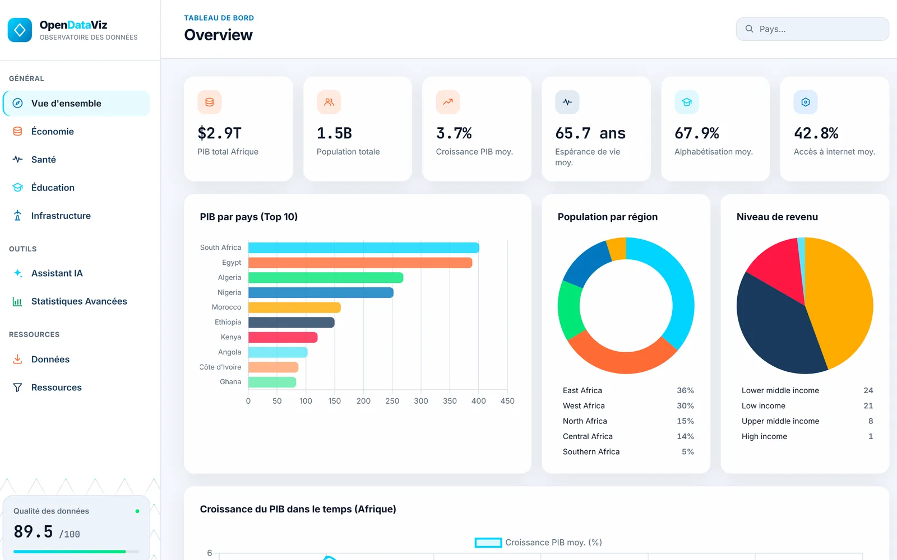
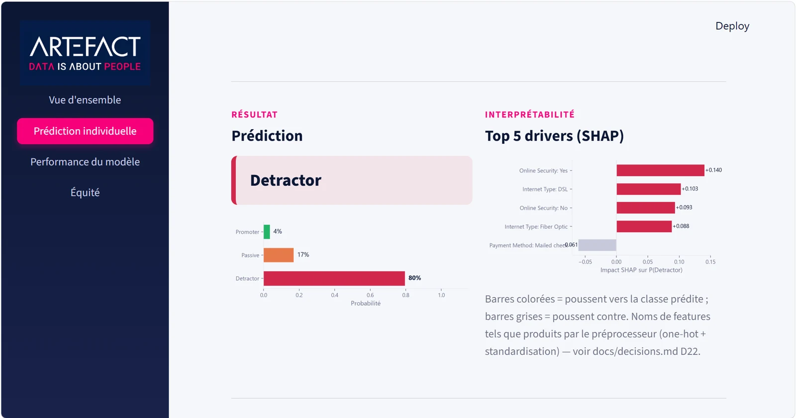
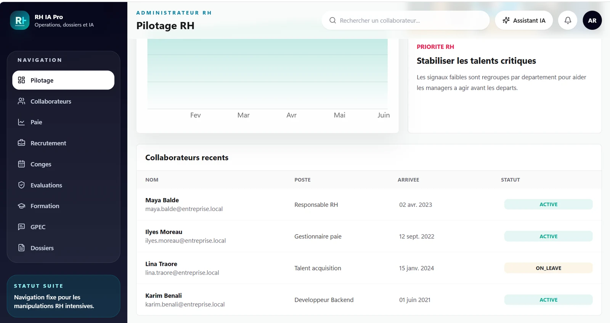
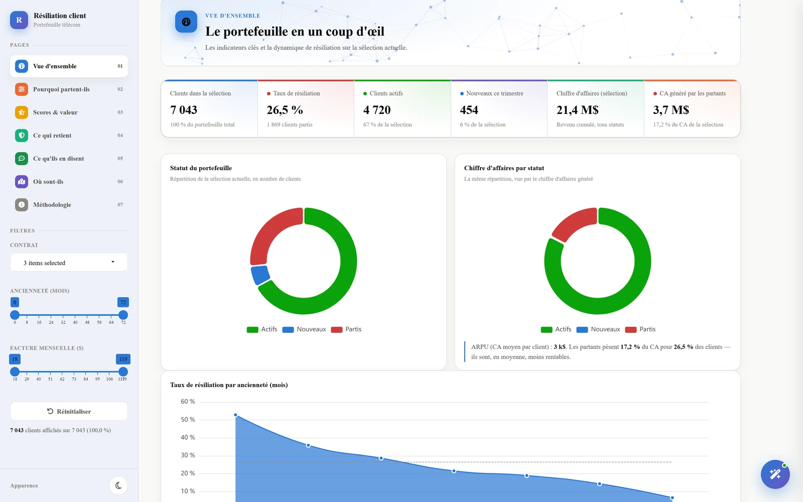

<a href="./README.md">Français</a> · <strong>English</strong>

<a href="https://www.grimael.dev/">
  <picture>
    <source media="(prefers-color-scheme: dark)" srcset="./assets/banner-en-dark.svg">
    <source media="(prefers-color-scheme: light)" srcset="./assets/banner-en-light.svg">
    
  </picture>
</a>

# Statistics, Data Science & Engineering

I'm **Michaël S. GRIMA**, a statistician trained at [ENSEA in Abidjan](https://ensea.ed.ci/). I connect statistical analysis, data engineering and application development to turn raw data into useful decisions.

My experience spans **insurance, public service and vocational training** in Côte d’Ivoire. This is where I share the tools and projects that put that work into practice.

  <a href="https://www.grimael.dev/"><strong>Portfolio</strong></a>
  &nbsp; / &nbsp;
  <a href="https://www.linkedin.com/in/grimael">LinkedIn</a>
  &nbsp; / &nbsp;
  <a href="mailto:grimamichael79@gmail.com">Get in touch</a>

## Selected work

From preparing the data to building the application that makes it useful.

<table>
  <tr>
    <td width="50%" valign="top">
      
      
<strong><a href="https://github.com/grimael/opendataviz-pipeline">OpenDataViz</a></strong> An observatory for exploring Africa’s economic and social data, from the ETL pipeline to the dashboard.

      
<code>Python</code> <code>DuckDB</code> <code>FastAPI</code>

      
<a href="https://github.com/grimael/opendataviz-pipeline">Source code</a> · <a href="https://www.grimael.dev/projects/opendataviz-observatoire-afrique/">Case study</a>

    </td>
    <td width="50%" valign="top">
      
      
<strong><a href="https://github.com/grimael/NPS_Project">NPS & Fairness</a></strong> Predicting customer satisfaction while accounting for selection bias, interpretability and model fairness.

      
<code>scikit-learn</code> <code>LightGBM</code> <code>SHAP</code>

      
<a href="https://github.com/grimael/NPS_Project">Source code</a> · <a href="https://www.grimael.dev/projects/prediction-nps-artefact/">Case study</a>

    </td>
  </tr>
  <tr>
    <td width="50%" valign="top">
      
      
<strong><a href="https://github.com/grimael/RH_Project">RH IA Pro</a></strong> An application bringing HR operations, analytics and automation into a consistent interface.

      
<code>React</code> <code>FastAPI</code> <code>PostgreSQL</code>

      
<a href="https://github.com/grimael/RH_Project">Source code</a> · <a href="https://www.grimael.dev/projects/rh-ia-pro/">Case study</a>

    </td>
    <td width="50%" valign="top">
      
      
<strong><a href="https://github.com/grimael/R_Data_Viz">Churn Telecom</a></strong> Understanding customer churn through statistical analysis, an R Shiny dashboard and an AI assistant.

      
<code>R</code> <code>Shiny</code> <code>Gemini</code>

      
<a href="https://github.com/grimael/R_Data_Viz">Source code</a> · <a href="https://www.grimael.dev/projects/dashboard-churn-telecom-ia/">Case study</a>

    </td>
  </tr>
</table>

[Explore all projects on my portfolio](https://www.grimael.dev/projects/)

## Areas of focus

**Statistics & Machine Learning** 
Explore, model, evaluate and interpret. 
`Python` `R` `scikit-learn` `pandas` `NumPy`

**Data Engineering** 
Collect, structure and automate reliable data flows. 
`SQL` `PostgreSQL` `Apache Hop` `dbt` `Talend`

**Business Intelligence** 
Build indicators and dashboards that support decisions. 
`Power BI` `Tableau` `Apache Superset` `R Shiny` `Excel`

**Applications & Web** 
Give analyses a usable interface and a practical purpose. 
`React` `Astro` `FastAPI` `Node.js` `Tailwind CSS`

Data collection, additional tools and collaboration

- **Data collection:** KoboToolbox, ODK, CSPro.
- **Visualization:** Matplotlib.
- **Web foundations:** HTML, CSS, JavaScript.
- **Collaboration and documentation:** Git, GitHub, LaTeX.

## How I build

1. **Understand.** Start with the business question, data sources and constraints.
2. **Structure.** Prepare the data and document the processing steps.
3. **Evaluate.** Choose appropriate methods and make their limitations explicit.
4. **Deliver.** Ship a useful analysis, dashboard or application.

---

**A data question, a tool to build or a collaboration in mind?** 
[Let’s talk](mailto:grimamichael79@gmail.com) · [My background](https://www.grimael.dev/about/) · [LinkedIn](https://www.linkedin.com/in/grimael)

Based in Abidjan, Côte d’Ivoire. Grounded in statistics. Driven to build.
