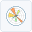

<strong>Français</strong> · <a href="./README.en.md">English</a>

<a href="https://www.grimael.dev/">
  <picture>
    <source media="(prefers-color-scheme: dark)" srcset="./banner.svg">
    <source media="(prefers-color-scheme: light)" srcset="./assets/banner-fr-light.svg">
    
  </picture>
</a>

# Statistique, Data Science & Engineering

Je suis **Michaël S. GRIMA**, statisticien formé à l’[ENSEA d’Abidjan](https://ensea.ed.ci/). Je relie l’analyse statistique, l’ingénierie des données et le développement d’applications pour transformer les données brutes en décisions utiles.

Mon parcours couvre **l’assurance, le service public et la formation professionnelle** en Côte d’Ivoire. Ici, je partage les outils et les projets qui donnent une forme concrète à ce travail.

  <a href="https://www.grimael.dev/"><strong>Portfolio</strong></a>
  &nbsp; / &nbsp;
  <a href="https://www.linkedin.com/in/grimael">LinkedIn</a>
  &nbsp; / &nbsp;
  <a href="mailto:grimael.s@outlook.com">Échanger par email</a>

## Projets sélectionnés

De la préparation des données à l’application qui les rend exploitables.

<table>
  <tr>
    <td width="50%" valign="top">
      <a href="https://github.com/grimael/opendataviz-pipeline"><picture><source media="(prefers-color-scheme: dark)" srcset="./assets/projects/opendataviz-dark.svg"><source media="(prefers-color-scheme: light)" srcset="./assets/projects/opendataviz-light.svg"></picture></a>
      
<strong><a href="https://github.com/grimael/opendataviz-pipeline">OpenDataViz</a></strong> Un observatoire pour explorer les données économiques et sociales de l’Afrique, du pipeline ETL au tableau de bord.

      
<code>Python</code> <code>DuckDB</code> <code>FastAPI</code>

      
<a href="https://github.com/grimael/opendataviz-pipeline">Code source</a> · <a href="https://www.grimael.dev/projects/opendataviz-observatoire-afrique/">Étude de cas</a>

    </td>
    <td width="50%" valign="top">
      <a href="https://github.com/grimael/NPS_Project"><picture><source media="(prefers-color-scheme: dark)" srcset="./assets/projects/nps-dark.svg"><source media="(prefers-color-scheme: light)" srcset="./assets/projects/nps-light.svg"></picture></a>
      
<strong><a href="https://github.com/grimael/NPS_Project">NPS & équité</a></strong> Prédire la satisfaction client en tenant compte du biais de sélection, de l’interprétabilité et de l’équité.

      
<code>scikit-learn</code> <code>LightGBM</code> <code>SHAP</code>

      
<a href="https://github.com/grimael/NPS_Project">Code source</a> · <a href="https://www.grimael.dev/projects/prediction-nps-artefact/">Étude de cas</a>

    </td>
  </tr>
  <tr>
    <td width="50%" valign="top">
      <a href="https://github.com/grimael/RH_Project"><picture><source media="(prefers-color-scheme: dark)" srcset="./assets/projects/rh-ia-pro-dark.svg"><source media="(prefers-color-scheme: light)" srcset="./assets/projects/rh-ia-pro-light.svg"></picture></a>
      
<strong><a href="https://github.com/grimael/RH_Project">RH IA Pro</a></strong> Une application pour centraliser les opérations RH, le pilotage et l’automatisation dans une interface cohérente.

      
<code>React</code> <code>FastAPI</code> <code>PostgreSQL</code>

      
<a href="https://github.com/grimael/RH_Project">Code source</a> · <a href="https://www.grimael.dev/projects/rh-ia-pro/">Étude de cas</a>

    </td>
    <td width="50%" valign="top">
      <a href="https://github.com/grimael/R_Data_Viz"><picture><source media="(prefers-color-scheme: dark)" srcset="./assets/projects/churn-telecom-dark.svg"><source media="(prefers-color-scheme: light)" srcset="./assets/projects/churn-telecom-light.svg"></picture></a>
      
<strong><a href="https://github.com/grimael/R_Data_Viz">Churn Télécom</a></strong> Comprendre les résiliations avec des analyses statistiques, un dashboard R Shiny et un assistant IA.

      
<code>R</code> <code>Shiny</code> <code>Gemini</code>

      
<a href="https://github.com/grimael/R_Data_Viz">Code source</a> · <a href="https://www.grimael.dev/projects/dashboard-churn-telecom-ia/">Étude de cas</a>

    </td>
  </tr>
</table>

[Voir l’ensemble de mes projets sur le portfolio](https://www.grimael.dev/projects/)

## Mon terrain de travail

**Statistique & Machine Learning** 
Explorer, modéliser, évaluer et interpréter. 
`Python` `R` `scikit-learn` `pandas` `NumPy`

     

**Data Engineering** 
Collecter, structurer et automatiser des flux de données fiables. 
`SQL` `PostgreSQL` `Apache Hop` `dbt` `Talend`

     

**Business Intelligence** 
Construire des indicateurs et des tableaux de bord pour la décision. 
`Power BI` `Tableau` `Apache Superset` `R Shiny` `Excel`

     

**Applications & Web** 
Donner aux analyses une interface et des usages concrets. 
`React` `Astro` `FastAPI` `Node.js` `Tailwind CSS`

     

**Environnement & IA**

   

Collecte, outils complémentaires et collaboration

- **Collecte de données :** KoboToolbox, ODK, CSPro.
- **Visualisation :** Matplotlib.
- **Fondations web :** HTML, CSS, JavaScript.
- **Collaboration et documentation :** Git, GitHub, LaTeX.

## Ma façon de construire

1. **Comprendre.** Partir de la question métier, des sources et des contraintes.
2. **Structurer.** Préparer les données et documenter les traitements.
3. **Évaluer.** Choisir des méthodes adaptées et expliciter leurs limites.
4. **Livrer.** Restituer une analyse, un tableau de bord ou une application utile.

---

**Une question data, un outil à construire ou une collaboration ?** 
[Échangeons](mailto:grimael.s@outlook.com) · [Mon parcours](https://www.grimael.dev/about/) · [LinkedIn](https://www.linkedin.com/in/grimael)

